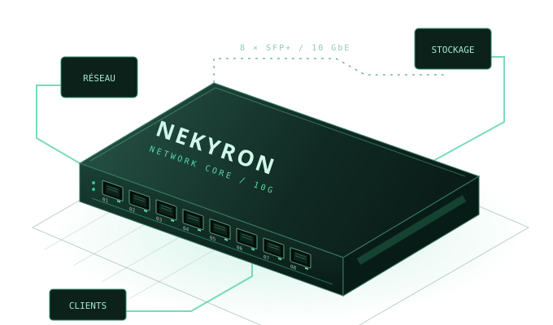

# Nekyron OpenWrt — SODOLA SL-SWTGW3C8F

[English](README.md) · [Français](README.fr.md) · [Deutsch](README.de.md) · [Español](README.es.md) · [Italiano](README.it.md) · [Português](README.pt.md)

Experimentelle Community-Firmware für **SODOLA SL-SWTGW3C8F / RTL9303 / 8 × SFP+ / 128 MiB RAM / 16 MiB SPI-Flash**. Kein offizielles OpenWrt- oder SODOLA-Release. Ein identischer SoC bedeutet nicht, dass andere Switch-Modelle kompatibel sind.

**[Downloads](https://github.com/Necrosiak/openwrt-sodola-sl-swtgw3c8f/releases) · [Einrichtung und Sicherheit](docs/de/GUIDE.md) · [Technische Referenz (Französisch)](docs/BUILD.md)**

## Enthalten

- Lokales Board-Profil und PHY-Korrekturen für bestimmte QINIYEK-/RTL8261BE-Module.
- LuCI über HTTPS, leichtes grünes Nekyron-Design mit lokalen SVGs und Portstatus.
- Verwaltung als DHCP-Client; direkte Wartungsadresse `169.254.1.1/24`.
- Adblock-fast mit LuCI-Oberfläche, zunächst deaktiviert; tcpdump-mini und Netzwerkdiagnose.
- 42 LuCI-Sprachpakete als separate APKs. Nicht übersetzte Texte fallen auf Englisch zurück.

## Wichtige Einschränkungen

**Das vollständige öffentliche Image wurde noch nicht auf echter Hardware gestartet.** CRC-, Größen-, Inhalts- und Konfigurationsprüfungen ersetzen keinen Hardwaretest. Die vorherige Plattformversion wurde auf einem Gerät benutzt; dies bestätigt nicht automatisch den neuen Build oder 10-Gb/s-Durchsatz zwischen Ports.

Root ist anfangs gesperrt. Mit einer kompatiblen seriellen Konsole und `passwd` ein eigenes Passwort setzen. Keine gemeinsamen Zugangsdaten, privaten Schlüssel oder Gerätesicherungen enthalten.

Tägliche GitHub-Actions-Builds erzeugen ungetestete Kandidaten aus aktuellen Upstream-Quellen. **Kein automatisches Flashen**, keine automatische Freigabe als validierte Version und keine Garantie, dass alle CVEs behoben sind.

Home Assistant: Integrationshinweise und ein optionales Nur-Lese-ACL sind vorbereitet. Die vollständige Steuerung von Ports/VLANs ist nicht getestet und kann eigene Aktionen erfordern.
