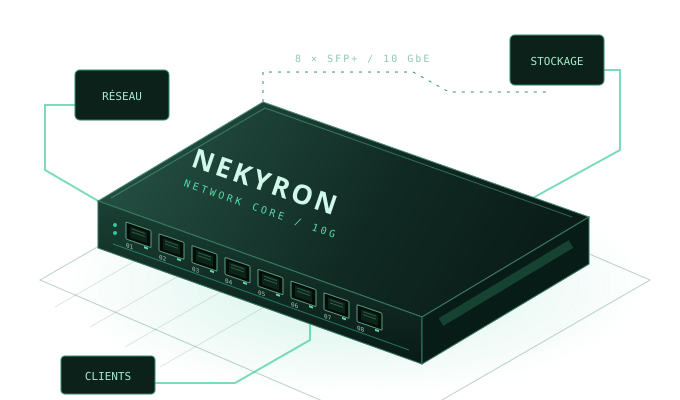

# Nekyron OpenWrt — SODOLA SL-SWTGW3C8F

[English](README.md) · [Français](README.fr.md) · [Deutsch](README.de.md) · [Español](README.es.md) · [Italiano](README.it.md) · [Português](README.pt.md)

Firmware comunitario experimental para **SODOLA SL-SWTGW3C8F / RTL9303 / 8 × SFP+ / 128 MiB de RAM / 16 MiB de flash SPI**. No es una versión oficial de OpenWrt ni de SODOLA. Compartir el mismo SoC no garantiza compatibilidad con otros modelos.

**[Descargas](https://github.com/Necrosiak/openwrt-sodola-sl-swtgw3c8f/releases) · [Instalación y seguridad](docs/es/GUIDE.md) · [Referencia técnica (francés)](docs/BUILD.md)**

## Incluye

- Perfil local de la placa y correcciones PHY para determinados módulos QINIYEK/RTL8261BE.
- LuCI mediante HTTPS y tema Nekyron verde y ligero, con SVG locales y estado de los puertos.
- Administración como cliente DHCP; dirección de mantenimiento directo `169.254.1.1/24`.
- Adblock-fast con interfaz LuCI, desactivado inicialmente; tcpdump-mini y herramientas de diagnóstico.
- 42 paquetes de idiomas de LuCI en APK separados. Los textos sin traducción aparecen en inglés.

## Límites importantes

**La imagen pública completa todavía no se ha arrancado en hardware real.** Las comprobaciones de CRC, tamaño, contenido y configuración no sustituyen una prueba física. La versión anterior de la plataforma se utilizó en un dispositivo; eso no valida automáticamente esta compilación ni transferencias de 10 Gb/s entre puertos.

Root está bloqueado inicialmente. Se necesita una consola serie compatible para establecer una contraseña propia mediante `passwd`. No se incluyen credenciales compartidas, claves privadas ni copias de seguridad de dispositivos.

GitHub Actions genera candidatos diarios sin probar a partir de las fuentes actuales. **No instala el firmware automáticamente**, no promueve versiones validadas y no garantiza resolver todas las vulnerabilidades CVE.

Home Assistant: se proporcionan instrucciones y una ACL opcional de solo lectura. La administración completa de puertos/VLAN no está validada y puede requerir acciones personalizadas.

