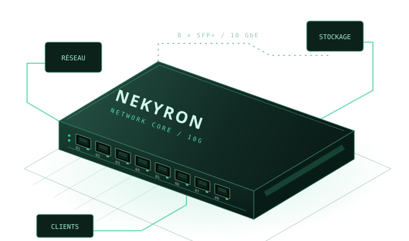

# Nekyron OpenWrt — SODOLA SL-SWTGW3C8F

[English](README.md) · [Français](README.fr.md) · [Deutsch](README.de.md) · [Español](README.es.md) · [Italiano](README.it.md) · [Português](README.pt.md)



Firmware communautaire expérimental pour **SODOLA SL-SWTGW3C8F, RTL9303, 8 × SFP+, 128 Mio RAM / 16 Mio flash**. Ce projet n'est ni un firmware officiel SODOLA, ni un profil officiellement pris en charge par OpenWrt. Une puce identique ne suffit pas à rendre un autre modèle compatible.

**[Téléchargements](../../releases) · [Installation](docs/INSTALLATION.md) · [Sécurité et mises à jour](docs/SECURITY.md) · [Home Assistant](docs/HOME-ASSISTANT.md) · [Langues](docs/LANGUAGES.md)**

## Inclus

- OpenWrt `realtek/rtl930x`, noyau 6.18.64 pour la version initiale, sources et feeds épinglés.
- Profil de carte SODOLA et correctifs locaux pour certains modules SFP+ cuivre QINIYEK / RTL8261BE : délai RollBall, conservation de leur configuration autonome, mode SGMII à 1 Gb/s.
- Gestion **client DHCP** ; adresse de maintenance universelle `169.254.1.1/24`. Aucun bail, adresse MAC ou mot de passe d'une installation particulière n'est inclus.
- LuCI HTTPS, thème **Nekyron** noir/vert : SVG locaux, fond Matrix, illustration et huit ports reflétant les données natives de LuCI. Argon et Bootstrap restent disponibles.
- `adblock-fast` avec interface LuCI, **désactivé**. `tcpdump-mini`, iperf3, ethtool, LLDP, SNMP, SQM et pilotes présents selon le manifeste. Les services optionnels restent désactivés au premier démarrage.
- Traductions LuCI distribuées en paquets séparés pour les langues disponibles ; les textes fonctionnels du thème réutilisent les catalogues natifs.
- Recettes de construction et construction GitHub Actions périodique de candidats amont, **sans flash automatique**.

## État de validation

Le socle précédent a démarré en RAM puis en flash sur un exemplaire de cette carte. Un lien à 1 Gb/s, DHCP et gestion HTTPS ont été testés. Des liens négociés à 2,5 et 10 Gb/s ont été observés. Un test Internet sur une machine reliée à 2,5 Gb/s a atteint environ 2,37 Gb/s en réception et 2,36 Gb/s en émission ; cela ne valide pas un débit de commutation à 10 Gb/s entre plusieurs ports.

**Les images publiques reconstruites avec le thème et les compléments sont des images distinctes : elles ne sont pas encore démarrées sur matériel.** Les vérifications de compilation, de CRC, de taille et de contenu ne remplacent pas un essai en RAM. Consultez `validation.json` dans chaque téléchargement.

## Première utilisation

Le mot de passe root est verrouillé au premier démarrage. Une **console série compatible et un accès physique** sont nécessaires pour définir votre propre mot de passe avec `passwd`. Les clés SSH et le certificat HTTPS sont générés sur chaque appareil. Le serveur DHCP reste désactivé : la box conserve son rôle.

Ne flashez pas une image destinée à un autre switch. La prise en charge d'un module cuivre ne garantit pas celle de toutes ses révisions. Gardez votre propre sauvegarde constructeur hors ligne ; aucune sauvegarde de l'appareil utilisé pour le développement n'est publiée.

## Construire

Sur Linux avec les dépendances OpenWrt installées :

```sh
JOBS=4 scripts/build.sh "$PWD/build"
python3 scripts/audit.py --tree . --build build
python3 scripts/collect.py build artifacts
```

`--rolling` suit les sources amont actuelles et construit un **candidat non testé**. Un conflit de correctif arrête la construction. [Détails et provenance](docs/BUILD.md).

## Licences

OpenWrt et ses composants conservent leurs licences respectives. Le profil de carte et les correctifs noyau suivent GPL-2.0-or-later ; les templates Argon et adaptations du thème sont sous Apache-2.0, avec les attributions amont conservées. Adblock-fast suit AGPL-3.0-or-later. Voir [licences et sources](docs/LICENSES.md).
