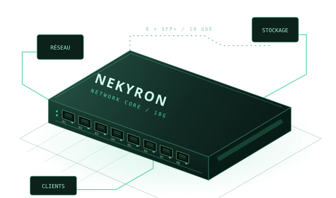

# Nekyron OpenWrt — SODOLA SL-SWTGW3C8F

[English](README.md) · [Français](README.fr.md) · [Deutsch](README.de.md) · [Español](README.es.md) · [Italiano](README.it.md) · [Português](README.pt.md)

Firmware sperimentale della comunità per **SODOLA SL-SWTGW3C8F / RTL9303 / 8 × SFP+ / 128 MiB RAM / 16 MiB flash SPI**. Non è una versione ufficiale OpenWrt o SODOLA. Lo stesso SoC non garantisce la compatibilità con altri modelli.

**[Download](https://github.com/Necrosiak/openwrt-sodola-sl-swtgw3c8f/releases) · [Installazione e sicurezza](docs/it/GUIDE.md) · [Riferimento tecnico (francese)](docs/BUILD.md)**

## Contenuto

- Profilo locale della scheda e correzioni PHY per alcuni moduli QINIYEK/RTL8261BE.
- LuCI tramite HTTPS, tema Nekyron verde e leggero con SVG locali e stato delle porte.
- Gestione come client DHCP; indirizzo di manutenzione diretta `169.254.1.1/24`.
- Adblock-fast con interfaccia LuCI, inizialmente disattivato; tcpdump-mini e diagnostica di rete.
- 42 pacchetti di lingua LuCI come APK separati. I testi non tradotti vengono mostrati in inglese.

## Limiti importanti

**L’immagine pubblica completa non è ancora stata avviata su hardware reale.** I controlli CRC, dimensioni, contenuto e configurazione non sostituiscono una prova fisica. La versione precedente della piattaforma è stata usata su un dispositivo; questo non convalida automaticamente la nuova build o il trasferimento a 10 Gb/s tra porte.

Root è inizialmente bloccato. Serve una console seriale compatibile per impostare una password personale con `passwd`. Non sono incluse credenziali condivise, chiavi private o copie di sicurezza di dispositivi.

GitHub Actions controlla le fonti ogni ora e genera candidati non testati quando cambiano. **Nessun aggiornamento automatico sullo switch**, nessuna promozione automatica a versione convalidata e nessuna garanzia di risolvere tutte le CVE.

Home Assistant: sono disponibili istruzioni e una ACL opzionale di sola lettura. La gestione completa di porte/VLAN non è stata convalidata e può richiedere azioni personalizzate.

[Certificati HTTPS](docs/HTTPS.md)

[Aggiornamenti firmati](docs/UPDATES.md)
