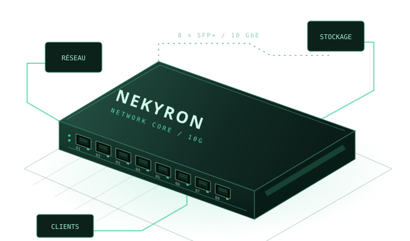

# Nekyron OpenWrt — SODOLA SL-SWTGW3C8F

[English](README.md) · [Français](README.fr.md) · [Deutsch](README.de.md) · [Español](README.es.md) · [Italiano](README.it.md) · [Português](README.pt.md)

Firmware comunitário experimental para **SODOLA SL-SWTGW3C8F / RTL9303 / 8 × SFP+ / 128 MiB de RAM / 16 MiB de flash SPI**. Não é uma versão oficial do OpenWrt ou da SODOLA. O mesmo SoC não garante compatibilidade com outros modelos.

**[Transferências](https://github.com/Necrosiak/openwrt-sodola-sl-swtgw3c8f/releases) · [Instalação e segurança](docs/pt/GUIDE.md) · [Referência técnica (francês)](docs/BUILD.md)**

## Incluído

- Perfil local da placa e correções PHY para determinados módulos QINIYEK/RTL8261BE.
- LuCI por HTTPS e tema Nekyron verde e leve, com SVG locais e estado das portas.
- Administração como cliente DHCP; endereço de manutenção direta `169.254.1.1/24`.
- Adblock-fast com interface LuCI, inicialmente desativado; tcpdump-mini e diagnóstico de rede.
- 42 pacotes de idiomas do LuCI em APK separados. Textos sem tradução são apresentados em inglês.

## Limitações importantes

**A imagem pública completa ainda não foi iniciada em hardware real.** As verificações de CRC, tamanho, conteúdo e configuração não substituem um teste físico. A versão anterior da plataforma foi utilizada num dispositivo; isso não valida automaticamente esta compilação nem transferências de 10 Gb/s entre portas.

Root começa bloqueado. É necessária uma consola série compatível para definir uma palavra-passe própria com `passwd`. Não são incluídas credenciais partilhadas, chaves privadas ou cópias de segurança de dispositivos.

O GitHub Actions verifica as fontes a cada hora e gera candidatos não testados quando mudam. **Não instala firmware automaticamente**, não promove versões validadas e não garante corrigir todas as CVE.

Home Assistant: são fornecidas instruções e uma ACL opcional apenas de leitura. A administração completa de portas/VLAN não está validada e pode exigir ações personalizadas.

[Certificados HTTPS](docs/HTTPS.md)

[Atualizações assinadas](docs/UPDATES.md)
